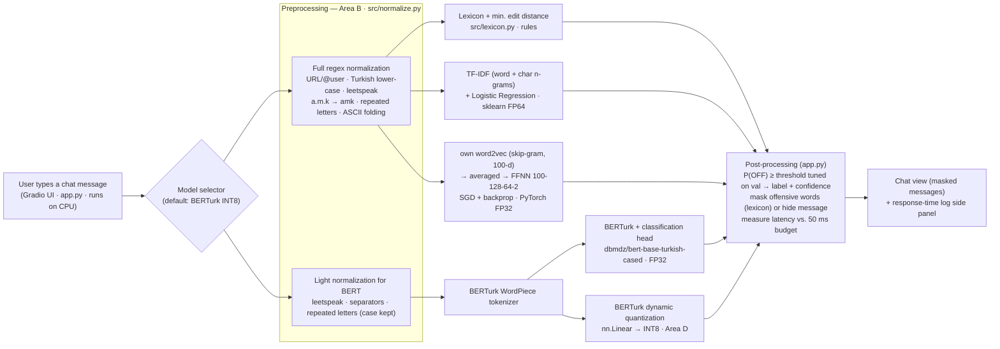

# Architecture (R6)

Every box below corresponds to a file in this repository.

Training / offline (not on the request path): `train/00_prepare_data.py` → `01_baselines.py` →
`02_word2vec_ffnn.py` → `03_finetune_bert.py` (Colab GPU) → `04_quantize.py` → `05_evaluate.py`
→ `06_push_to_hub.py` (weights to Hugging Face Hub; the app downloads them on first start).
